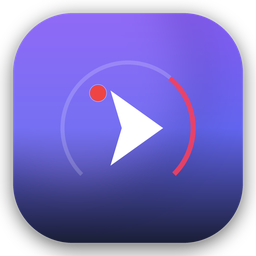
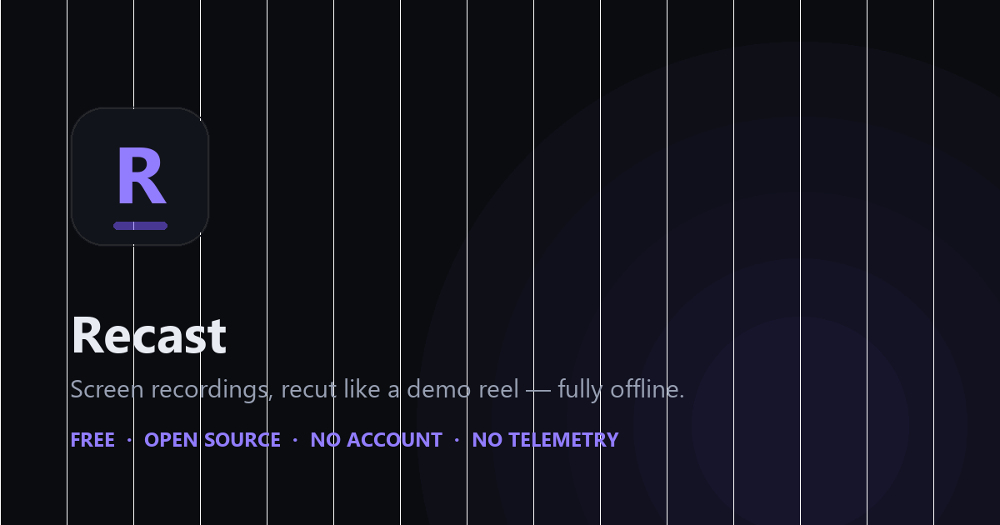
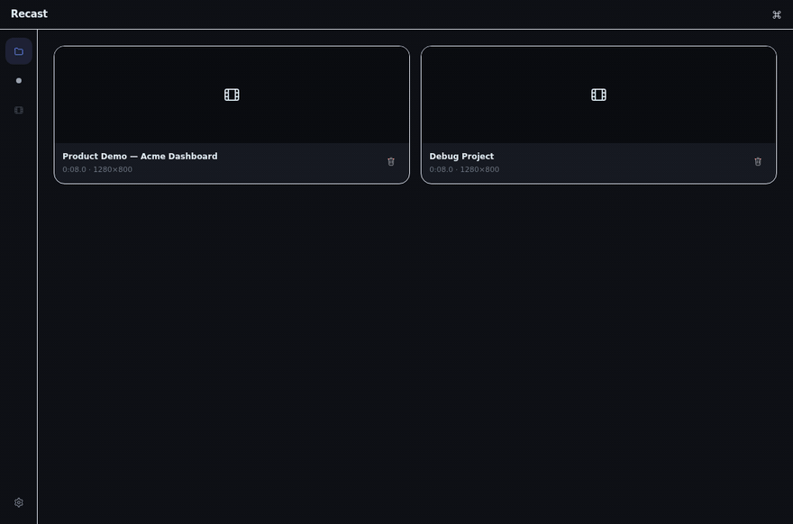
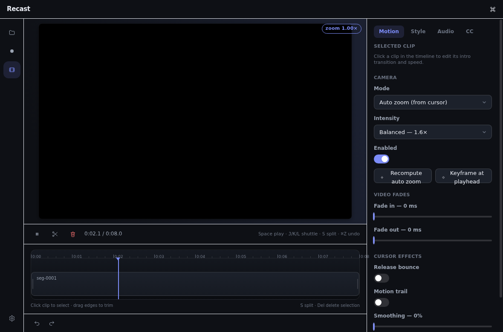
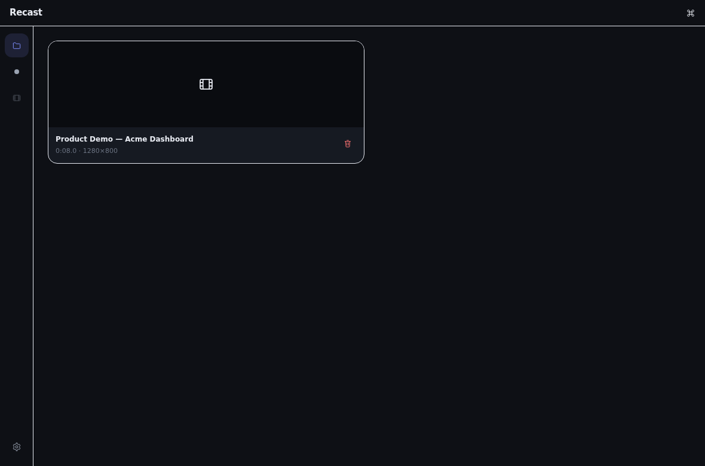
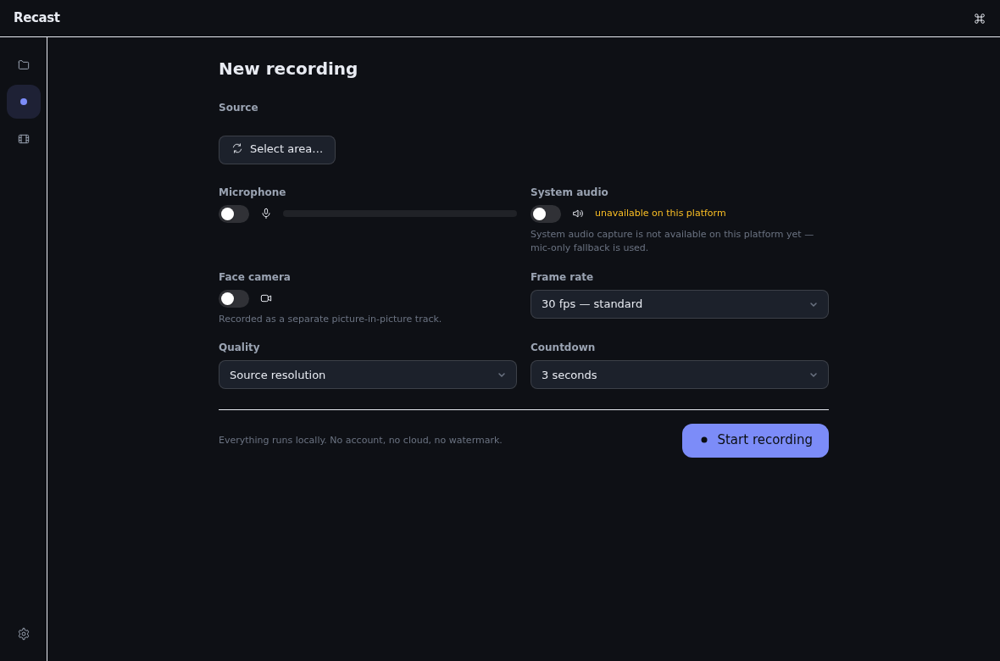
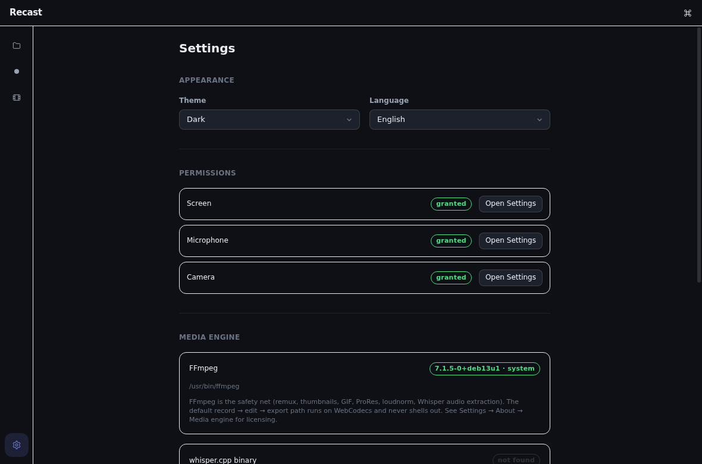
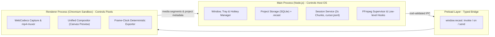

<div align="center">



# Recast

**The local-first screen recorder and cinematic video editor.**

Record, auto-zoom, annotate, overlay keystrokes, and export high-impact product demos.  
100% offline. Zero accounts. Zero cloud lock-in. Zero telemetry. Zero watermarks. Free forever under GPL-3.0.

[](https://github.com/SudhirDevOps1/recast/actions/workflows/ci.yml)
[](https://github.com/SudhirDevOps1/recast/actions/workflows/release.yml)
[](https://github.com/SudhirDevOps1/recast/actions/workflows/codeql.yml)
[](LICENSE)
[](https://sudhirdevops1.github.io/recast/)
[](https://github.com/SudhirDevOps1/recast/releases/latest)

<br />



<br />

**[Download](#install) · [Product Tour](#product-tour) · [Documentation](docs/README.md) · [Deployment Guide](docs/deployment.md) · [Security](docs/security.md) · [Website](https://sudhirdevops1.github.io/recast/) · [Status](STATUS.md)**

</div>

---

## Why Recast?

| Feature | Screen Studio ($29/mo) | OBS Studio | Recast (Free & Open Source) |
|---|---|---|---|
| **License & Price** | Commercial ($29/month) | GPL-2.0 (Free) | **GPL-3.0 (100% Free Forever)** |
| **Data Privacy** | Cloud account required | 100% Local | **100% Offline, Zero Telemetry** |
| **Automatic Zooms** | Proprietary algorithm | None (Manual filters) | **Dwell & Click Heuristics + 1-Click Suggestions** |
| **Live Annotations** | Post-production only | Complex plugin setup | **Built-in Floating Pill Toolbar** |
| **Keystroke HUD** | Yes | Third-party software | **Native Low-latency Hardware HUD Overlay** |
| **Crash Protection** | In-memory / temp files | Direct writing | **Segmented 2s Chunks + Atomic Manifest** |
| **Determinism** | Black-box exporter | Varied | **Single Compositor Contract (Preview = Export)** |

### Core Guarantees

- **100% Offline & Private:** Zero network requests by default. No analytics, no telemetry, no crash pings. Your audio, screen captures, and projects never touch a remote server.
- **Unified Compositor:** The exact same rendering engine (`packages/editor/src/compositor.ts`) drives both real-time canvas preview and final multi-format export. What you preview is byte-for-byte what gets rendered.
- **Crash-Safe Segmented Pipeline:** Screen and audio are captured in isolated 2-second segments with atomic index manifests. Even if the host machine experiences a power outage during recording, the session is fully recoverable.
- **Frame-Clock Deterministic Export:** Never relies on `requestAnimationFrame` for timeline rendering. Exports proceed tick-by-tick with exact sub-pixel positioning, dynamic motion blur, and EBU R128 (-14 LUFS) loudnorm audio normalization.
- **Enterprise-Ready Deployment:** Distributable via silent MSI, GPO/MDM deployment profiles, standalone single-file portable executables, and cryptographically verified SHA-256 hash manifests.

---

## New in v0.1.4: Market Parity Upgrade

- **P0-1 Suggest Zooms:** 1-click intelligent zoom proposals based on cursor dwell ($\le 8\text{ px}$ for $\ge 500\text{ ms}$) and click clusters, allowing instant cinematic framing.
- **P0-2 Live Floating Annotation Toolbar:** Minimalist 440px desktop pill toolbar during recording with Pen, Highlighter, Arrow, and Bounding Box tools streaming vector strokes to `annotations.jsonl`.
- **P0-3 Keystroke HUD (Shortcut Overlays):** Low-latency hardware key capturing via `uiohook-napi` rendered directly as floating dark-glass keycaps on both preview and export.
- **Hardened Stop Flow:** Guaranteed window teardown and atomic buffer flushing, eliminating any lingering background processes or hanging recorder sessions.
- **High-Craft Branding:** Redesigned studio squircle icon and cross-platform high-DPI asset pipeline.

---

## Capabilities at a Glance

Legend: **verified** = tested on OS · **implemented** = code complete, device QA pending · **partial** = scaffolded · **not built**.

| Area | Capability | State |
|---|---|---|
| **Capture** | Full screen, specific window, and custom area capture | implemented |
| **Capture** | Microphone and system audio recorded to isolated lossless tracks | implemented |
| **Capture** | Live floating annotation toolbar (pen, highlighter, arrows, boxes) | implemented |
| **Capture** | Hardware keystroke sampling (global keydown and shortcut tracking) | implemented |
| **Capture** | Crash-safe segmented writing (2-second fragments, atomic manifest) | implemented |
| **Capture** | Face-cam picture-in-picture (synchronized camera take with custom masks) | implemented |
| **Capture** | 60 Hz cursor sampling, global hotkeys, system tray integration | implemented |
| **Editor** | Dynamic FrameSync preview lifecycle + segment-local seek mapping | verified (unit) |
| **Editor** | Auto-zoom engine (3 intensities) + "Suggest Zooms" heuristic analysis | verified (unit) |
| **Editor** | Multi-track timeline: ruler, trim, split, ripple delete, draggable keyframes | implemented |
| **Editor** | Motion panel: intro transitions, per-clip speed (0.25x–4x), spring physics | verified (unit) |
| **Editor** | Style system: aspect ratios, mesh/gradient/solid backgrounds, `.recaststyle` presets | verified (unit) |
| **Editor** | Keystroke HUD renderer (dark glass pill keycaps with automated decay) | verified (unit) |
| **Export** | MP4 (H.264), WebM (VP8/VP9), ProRes 422/4444, and high-framerate animated GIF | implemented |
| **Export** | Frame-clock exporter (no dropped frames), EBU R128 audio normalization | implemented |
| **Captions** | Local Whisper speech-to-text via `whisper.cpp`, SRT/VTT import/export | partial |
| **Distribution** | NSIS, MSI Enterprise, Portable, ARM64, macOS DMG, AppImage, deb, rpm | verified in CI |

The complete, per-item verification status lives in [STATUS.md](STATUS.md).

---

## Product Tour

A fully native, offline desktop studio designed for engineering demos, feature walk-throughs, and polished documentation:



| Studio Editor (Auto-Zoom, Styles, Timeline) | Project Library |
|---|---|
|  |  |

| Studio Capture Setup | Settings & Audio Preferences |
|---|---|
|  |  |

---

## Architecture

Recast enforces a strict one-way trust boundary between native OS operations and sandboxed pixel rendering:



- **Sandboxed Renderer:** The browser window has `nodeIntegration: false`, `contextIsolation: true`, and `sandbox: true`. No native system APIs can be invoked directly from the DOM.
- **Strict IPC Contracts:** Every inter-process channel is defined in `packages/shared/src/ipc.ts` with explicit bidirectional Zod schemas.
- **Process Isolation:** FFmpeg and child utilities are executed strictly with `shell: false`, argument arrays, and verified binary paths.

Full details are documented in [docs/architecture.md](docs/architecture.md).

---

## Install

Official installers are published on [GitHub Releases](https://github.com/SudhirDevOps1/recast/releases) and the [Recast Website](https://sudhirdevops1.github.io/recast/). Every release publishes a cryptographic `SHA256SUMS` file.

| Platform | Format | Deployment Profile |
|---|---|---|
| **Windows x64** | `Recast-Setup-x.y.z.exe` | Standard NSIS installer (per-user, no UAC elevation required) |
| **Windows x64** | `Recast-x.y.z-enterprise.msi` | Per-machine Windows Installer for GPO / MDM / silent distribution |
| **Windows x64** | `Recast-Portable-x.y.z.exe` | Zero-install portable executable; keeps settings adjacent to binary |
| **Windows ARM64**| `Recast-Setup-x.y.z-arm64.exe`| Optimized native ARM64 executable for Snapdragon / Surface devices |
| **macOS arm64** | `Recast-x.y.z-arm64.dmg` | Native Apple Silicon (M1/M2/M3/M4) installer |
| **macOS x64** | `Recast-x.y.z-x64.dmg` | Intel 64-bit installer |
| **Linux x64** | `Recast-x.y.z-x86_64.AppImage` | Universal binary for X11 & Wayland (via desktop portal) |
| **Linux Packages**| `.deb` / `.rpm` / `.tar.gz` | Debian, Ubuntu, Fedora, RHEL packages |

> **Note on code signing:** Binaries are currently unsigned until code signing certificates land. On Windows, choose *More info → Run anyway* if SmartScreen appears. On macOS, right-click and choose *Open* or run `xattr -cr /Applications/Recast.app`. See [docs/code-signing.md](docs/code-signing.md) for roadmap details.

---

## Enterprise Deployment

Recast is purpose-built for zero-trust, air-gapped, and locked-down corporate environments:
- **Zero Inbound/Outbound Networking:** No firewall exceptions, allow-listing, or outbound proxy configuration needed.
- **Silent MSI Rollout:** Supports standard enterprise installation flags:
  ```cmd
  msiexec /i Recast-0.1.4-enterprise.msi /qn /norestart ALLUSERS=1
  ```
- Detailed GPO instructions, checksum verification, and registry paths are available in the [Deployment Guide](docs/deployment.md).

---

## Building from Source

### Prerequisites
- Node.js >= 20.11 (22 LTS recommended)
- pnpm >= 9.0.0
- Python 3 (for asset generation scripts)

### Setup & Compilation

```bash
# Clone the repository
git clone https://github.com/SudhirDevOps1/recast.git
cd recast

# Install workspace dependencies
pnpm install

# Fetch and stage platform FFmpeg safety net binaries (pinned SHA-256)
pnpm fetch:ffmpeg

# Run full quality gates (TypeCheck + Lint + Unit Tests + Build)
pnpm verify

# Launch the app in development mode
pnpm dev
```

### Packaging Binaries

```bash
pnpm dist:win      # Builds NSIS, MSI, Portable, and ARM64 on Windows
pnpm dist:mac      # Builds DMG for Apple Silicon and Intel on macOS
pnpm dist:linux    # Builds AppImage, deb, rpm, and tar.gz on Linux
```

---

## Documentation Index

| Topic | Documentation Link |
|---|---|
| **Overview & Index** | [docs/README.md](docs/README.md) · Master guide and directory structure |
| **User Manual** | [docs/recording.md](docs/recording.md) · [docs/editing.md](docs/editing.md) · [docs/export.md](docs/export.md) · [docs/keyboard-shortcuts.md](docs/keyboard-shortcuts.md) |
| **Enterprise & IT** | [docs/deployment.md](docs/deployment.md) · [docs/security.md](docs/security.md) · [docs/platform-support.md](docs/platform-support.md) · [docs/support.md](docs/support.md) |
| **Engineering** | [docs/architecture.md](docs/architecture.md) · [docs/build.md](docs/build.md) · [docs/packaging.md](docs/packaging.md) · [docs/ffmpeg.md](docs/ffmpeg.md) |
| **Project Governance**| [STATUS.md](STATUS.md) · [CHANGELOG.md](CHANGELOG.md) · [AGENTS.md](AGENTS.md) · [docs/market-parity.md](docs/market-parity.md) |

---

## Security & Responsible Disclosure

Security is treated as a foundational constraint:
- Sandboxed Chromium renderer with strict Content Security Policy (CSP).
- Zero remote scripts, zero inline scripts, no runtime evaluation (`unsafe-eval` disabled).
- Argument-array-only process execution without shell wrappers.
- Cryptographic SHA-256 verification of external tools (`ffmpeg.lock.json`).

Please do not report security vulnerabilities via public GitHub issues. Follow the confidential disclosure policy in [SECURITY.md](SECURITY.md).

---

## License

Recast is licensed under the [GNU General Public License v3.0 or later](LICENSE).  
Bundled FFmpeg distributions include `libx264` (GPL). For licensing terms and redistributions without GPL components, see [docs/ffmpeg.md](docs/ffmpeg.md).
