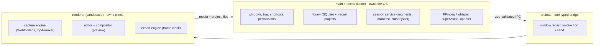

<div align="center">


# Recast

**Free, open-source, local-first screen recorder and cinematic editor.**

Record, auto-zoom, caption, export - no account, no cloud, no telemetry, no watermark, no feature gates.
Everything runs 100% offline on your machine. macOS - Windows - Linux.

[](https://github.com/SudhirDevOps1/recast/actions/workflows/ci.yml)
[](https://github.com/SudhirDevOps1/recast/actions/workflows/release.yml)
[](https://github.com/SudhirDevOps1/recast/actions/workflows/build.yml)
[](https://github.com/SudhirDevOps1/recast/actions/workflows/codeql.yml)
[](LICENSE)
[](https://sudhirdevops1.github.io/recast/)
[](https://github.com/SudhirDevOps1/recast/releases/latest)


**[Download](#install) - [Documentation](docs/README.md) - [Deployment guide](docs/deployment.md) - [Security](docs/security.md) - [Website](https://sudhirdevops1.github.io/recast/) - [Status](STATUS.md)**

</div>

---

## Why teams pick it

| | |
|---|---|
| **Nothing leaves the machine** | Zero network requests by default. No account, no analytics, no crash reporting. Footage is written to disk and stays there. |
| **Deterministic output** | Preview and export render through the same compositor, so what you see is what you ship. Every export is verified with `ffprobe` before the file is renamed into place. |
| **Auditable artifacts** | Every release publishes `SHA256SUMS`; the website shows the first bytes of each file's SHA-256 so you can match a download against the published hash. |
| **No feature gate, no seat count** | GPL-3.0, free forever. Nothing is held back behind a subscription, an account, or a licence server. |

## Capabilities at a glance

Legend: **verified** = tested on that OS - **implemented** = code complete, device QA pending - **partial** = scaffolded - **not built**.

| Area | Capability | State |
|---|---|---|
| Capture | Screen / window / area capture, mic + system audio on separate tracks, countdown, pause/resume | implemented |
| Capture | Crash-safe segmented writing (2 s fragments, atomic manifest), recovery remux | implemented |
| Capture | Encoder fallback chain that probes by configuring, plus a VP8/VP9 compatibility mode | verified (unit) |
| Capture | Face-cam picture-in-picture - opt-in camera take recorded beside the screen take, drawn as an overlay in preview and export | implemented - Windows camera QA pending |
| Capture | 60 Hz cursor sampling, global hotkeys, tray control, live recorder stats | implemented |
| Editor | Preview frame lifecycle (FrameSync) + segment-local seek mapping - no more black preview or export frames | verified (unit) |
| Editor | Cursor track to auto-zoom (3 intensities), manual keyframes with easing, follow-cursor | verified (unit) |
| Editor | Timeline 2.0 - ruler, trim, split, ripple delete, draggable keyframes, undo/redo | implemented |
| Editor | Motion panel - intro transitions, per-clip speed 0.25-4x, fades, cursor FX | verified (unit) |
| Editor | Style system - aspect ratios, background (solid, gradient, mesh, echo, **image**, transparent), cursor looks, `.recaststyle` presets, command palette | verified (unit) |
| Editor | Face-cam panel, cursor FX controls (smoothing, trail, click bounce), Library poster thumbnails, export presets | implemented |
| Export | MP4 (H.264), WebM, GIF, ProRes; HEVC where the platform provides it | implemented |
| Export | Frame-clock exporter (never rAF), loudnorm to -14 LUFS, cancel leaves no partial file | implemented |
| Captions | Local Whisper via `whisper.cpp`, SRT/VTT import/export, burn-in styles | partial - untested end to end |
| Distribution | NSIS, MSI, portable, ARM64, DMG arm64/x64, AppImage, deb, rpm, tar.gz, updater feed | verified in CI |
| Distribution | Code signing and notarization | not built - certificates pending |
| Platform | Windows 10 1809+, macOS 12.3+, Linux X11 (Wayland via portal, reduced feature set) | see [platform support](docs/platform-support.md) |

The full, per-item truth lives in [STATUS.md](STATUS.md) - nothing is claimed as working that was not tested.

## Product tour

60-second tour of the real app - nothing mocked: open a recording, watch the auto-zoom preview play,
restyle live, then export and verify the file.


| Editor - auto-zoom, styles, captions | Library |
|---|---|
|  |  |

| New recording | Settings |
|---|---|
|  |  |

*Regenerate the demo and the stills with `node scripts/capture-demo.mjs` and `node scripts/capture-screenshots.mjs`.*

## Architecture at a glance



One direction of trust: the renderer is sandboxed and never touches Node; every IPC channel is declared once
with a zod schema and validated on both ends. Full detail in [docs/architecture.md](docs/architecture.md).

## Install

| Platform | Artifact | Deployment profile |
|---|---|---|
| Windows x64 | `Recast-Setup-x.y.z.exe` | NSIS, per-user, no UAC prompt |
| Windows x64 | `Recast-x.y.z-enterprise.msi` | Per-machine, for GPO / silent deployment |
| Windows x64 | `Recast-Portable-x.y.z.exe` | Runs from a USB stick, settings next to the exe |
| Windows ARM64 | `Recast-Setup-x.y.z-arm64.exe` | Native ARM64 build |
| macOS arm64 | `Recast-x.y.z-arm64.dmg` | Apple Silicon - **unsigned until certificates land** |
| macOS x64 | `Recast-x.y.z-x64.dmg` | Intel - **unsigned until certificates land** |
| Linux x64 | `Recast-x.y.z-x86_64.AppImage` | X11 full support, Wayland through the portal |
| Linux x64 | `.deb` / `.rpm` / `.tar.gz` | Plus Flatpak, Snap and AUR manifests (authored, not yet submitted) |

Get the files from [Releases](https://github.com/SudhirDevOps1/recast/releases) or the
[website](https://sudhirdevops1.github.io/recast/), which resolves the right artifact for your platform.
Every release publishes `SHA256SUMS`.

> **Installers are currently unsigned.** Windows may show SmartScreen, macOS needs
> `xattr -cr` or right-click - Open on first launch. This is stated, not hidden - see
> [docs/code-signing.md](docs/code-signing.md) for the signing plan and the reputation note.

## Deploy in a locked-down environment

Recast makes no network calls by default, so it can be installed from an internal share with no proxy
and no allow-listing. The [deployment guide](docs/deployment.md) covers silent MSI installs, GPO and MDM
rollouts, offline checksum verification, version pinning and data locations.

## Build from source

```bash
pnpm install
pnpm fetch:ffmpeg   # optional: bundle the FFmpeg safety net (see docs/ffmpeg.md)
pnpm verify         # typecheck + lint + unit tests + build
pnpm dev            # run the app in dev mode
pnpm dist:win       # or dist:mac / dist:linux
```

Requirements: Node >= 20.11 (22 recommended), pnpm 9. Full setup, native module notes and the workspace
layout are in [docs/build.md](docs/build.md).

## Documentation

| Audience | Start here |
|---|---|
| Everyone | [docs/README.md](docs/README.md) - the documentation index |
| End user | [recording](docs/recording.md) - [editing](docs/editing.md) - [export](docs/export.md) - [keyboard shortcuts](docs/keyboard-shortcuts.md) |
| IT / operations | [deployment](docs/deployment.md) - [security](docs/security.md) - [support](docs/support.md) - [platform support](docs/platform-support.md) |
| Engineer | [architecture](docs/architecture.md) - [build](docs/build.md) - [packaging](docs/packaging.md) - [code signing](docs/code-signing.md) - [FFmpeg](docs/ffmpeg.md) |
| Maintainer | [roadmap](docs/roadmap.md) - [STATUS.md](STATUS.md) - [repository setup](docs/repository-setup.md) - [AGENTS.md](AGENTS.md) |

## Security and privacy

The renderer is sandboxed, IPC is schema-validated on both ends, child processes are spawned without a
shell and verified against pinned SHA-256 hashes before they can run, and the default build performs no
network requests at all. Recast does not encrypt data at rest - if your threat model includes local disk
access, use full-disk encryption. The threat model, the data-flow table and how to report a vulnerability
are in [docs/security.md](docs/security.md) and [SECURITY.md](SECURITY.md).

## Support

Recast is maintained in the open with no support SLA. Before filing an issue, export the diagnostics
bundle (Settings - Diagnostics - Copy diagnostics bundle) - it carries the app, OS, FFmpeg and display
permission state plus the last 200 capture log lines. Known issues, a bug-report template and the
response expectations are in [docs/support.md](docs/support.md).

## Contributing

Issues and pull requests are welcome; the build, test and commit rules are in
[CONTRIBUTING.md](CONTRIBUTING.md), the repository rules for coding agents in [AGENTS.md](AGENTS.md), and
the release history in [CHANGELOG.md](CHANGELOG.md). Security reports must not be filed as public issues -
use the private channel described in [SECURITY.md](SECURITY.md).

## License

GPL-3.0-or-later. Recast ships FFmpeg builds that include libx264 (GPL); see
[docs/ffmpeg.md](docs/ffmpeg.md) for the licensing story and the MIT/LGPL alternative for redistributions
that strip the binaries.
