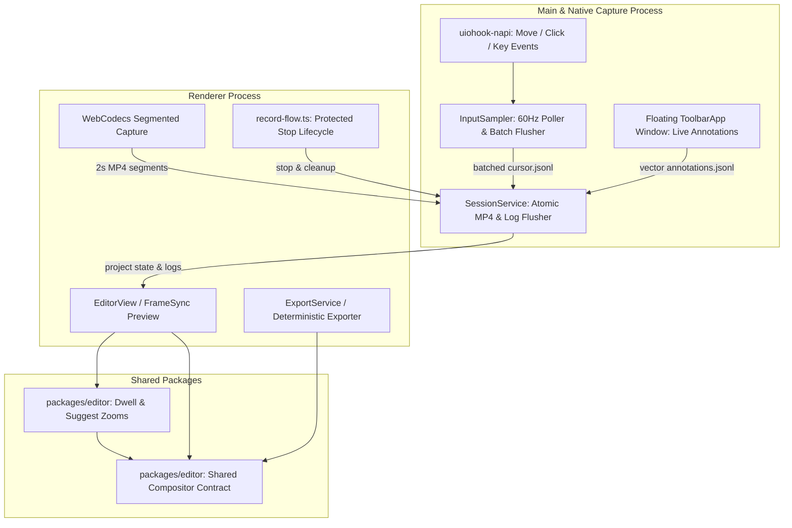

# Design Document: Recast Market Parity & Enterprise Architecture Hardening

## Overview & Goals

### The Problem
When recording screen workflows, modern users expect the final output to look professionally produced without manual editing timelines or cloud video processing. Proprietary tools like Screen Studio command high subscription costs ($29/month) while routing raw recording assets through third-party servers. 

Recast was established to provide an offline-first, private desktop recorder with deterministic WebCodecs compositing. However, competitive analysis (`docs/market-parity.md`) reveals distinct capability gaps against open-source alternatives (Capptivo, Focra, Recordly, Reframed, screenize):
1. **Unstable Process Teardown & Stop Lifecycle**: Stopping long takes previously encountered race conditions in asynchronous track cleanup, holding auxiliary windows (`toolbarWindow`, `areaWindow`) and orphan Electron processes active.
2. **Absence of Intelligent Zoom Suggestions**: While auto-zoom clustering existed, users lacked one-click post-recording zoom proposals (combining cursor dwell pauses with clicks).
3. **Missing Live Interaction Guidance**: Recast lacked real-time on-screen vector annotations (pen, highlighter, shapes) and live keystroke overlays, forcing creators to rely on external markup tools.
4. **Framing & Aspect Adaptation Constraints**: Multi-aspect exports (9:16 vertical, 1:1 square) required manual camera realignment rather than automatic re-aiming of keyframes.

### Goals
- **Deterministic Offline Quality**: Deliver 100% offline desktop capture and editing with zero telemetry, cloud dependencies, or feature gates.
- **Fail-Safe Lifecycle**: Ensure every recording stop terminates cleanly, flushes batched input/vector logs atomically, and transitions to the Editor within $\le 500$ ms with zero lingering window processes.
- **P0 Market Parity**:
  - **P0-1 Suggest Zooms**: Propose discrete, reviewable zoom keyframes derived from both click clusters and cursor dwell pauses ($\le 8$ px for $\ge 500$ ms).
  - **P0-2 Live Annotation Toolbar**: Provide an on-screen floating vector toolbar (Pen, Highlighter, Arrow, Rect) that records timestamped vector data without disrupting the capture clock or dropping frames.
  - **P0-3 Keystroke HUD**: Sample system keyboard events via `uiohook-napi`, batch them into session logs, and render styled keycaps through the single shared compositor contract.
  - **P0-4 & P0-5 Foundations**: Support fixed zoom regions and loop/spotlight effects.
- **Architectural Invariance**: Strictly adhere to the single compositor contract (`packages/editor/src/compositor.ts`) so preview and export render identical pixels.

### Non-Goals
- **Cloud Rendering or Telemetry**: No user telemetry, account sign-in, remote storage, or cloud video rendering.
- **Non-Native Workarounds**: Never introduce fake controls, mock buttons, or bypass OS permission boundaries.
- **Arbitrary Remux Hard-Dependencies**: WebCodecs remains the core path; FFmpeg serves purely as an offline safety net for probing and special containers (ProRes/GIF).

---

## Technical Plan

### System Architecture Diagram

### Component Breakdown & Implementation Mechanics

#### 1. Lifecycle Hardening & Clean Process Teardown
- **Renderer `record-flow.ts`**:
  - Wrapped `handle.stop()` and `capture:attachAudio` invocations inside a protected `try/catch/finally` block.
  - `releaseRendererRecorder()` executes unconditionally in `finally`, guaranteeing that local MediaStream tracks are terminated even if the container muxer encounters an error.
- **Main `ipc.ts` (`recorder:stop`)**:
  - Automatically queries and closes all active secondary floating windows (`toolbarWindow`, `areaWindow`).
  - Calls `c.inputSampler?.stop()` to flush and close file handles before marking the session as `completed`.
  - Clears `c.activeSessionId` to unlock the app for subsequent takes.

#### 2. P0-1: Zoom Suggestion Engine (`packages/editor/src/zoom-math.ts`)
- **Dwell Heuristic Detection**:
  - Computes spatial distance $\Delta d = \sqrt{(x - x_0)^2 + (y - y_0)^2}$ across cursor samples at 60 Hz.
  - When $\Delta d \le 8$ px for a duration $\ge 500$ ms, emits an interest point with weight $1.5$.
- **Heuristic Selection**:
  - `clicks`: Only user click events trigger interest points.
  - `dwell`: Only stationary dwelling triggers interest points (speed threshold ignored).
  - `combined`: Both clicks and dwell points are fed into the clusterer (`clusterInterests`).
- **One-Click Suggestion Flow**:
  - In `MotionPanel.tsx`, clicking "Suggest zooms" generates proposed keyframes and commits them to `project.zoom.manualKeyframes`. Each suggestion is fully editable, undoable, and deletable on the timeline.

#### 3. P0-3: Keystroke HUD (`input-sampler.ts` & `compositor.ts`)
- **Native Key Hook**:
  - `uiohook-napi` subscribes to `keydown` events in `InputSampler`.
  - Translates native keycodes using reverse mapping of `UiohookKey` into normalized tokens (e.g. `Ctrl`, `Alt`, `Shift`, `A`, `Enter`).
  - Appends events to `cursor.jsonl` with capture-clock microsecond timestamps.
- **Compositor Rendering**:
  - `computeComposition` evaluates active keypresses occurring within a sliding 1,200 ms window.
  - `drawKeystrokes` renders floating dark-glass pill keycaps (`rgba(18, 22, 30, 0.88)` with `rgba(255, 255, 255, 0.18)` hairline borders) horizontally centered at the bottom of the canvas.
  - Alphas fade gracefully over their 1.2s lifetime using closed-form clamping.

#### 4. P0-2: Live Floating Annotation Toolbar (`ToolbarApp.tsx`)
- **Expanded Toolbar Surface**:
  - 440px wide floating window with pill design, backdrop blur, and tool selector (Select, Pen, Highlighter, Arrow, Box).
  - Color palette switcher (`#EF4444`, `#7C8CF8`, `#10B981`, `#F59E0B`).
- **Non-Blocking Persistence**:
  - Emits strokes via `capture:appendAnnotation` IPC directly into `annotations.jsonl`.
  - Automatically read by `buildProjectFromSession` so annotations exist immediately on the project timeline upon stop.

---

## Alternatives Considered & Trade-offs

| Alternative Considered | Evaluated Trade-offs | Reason for Rejection |
|---|---|---|
| **Pixel-burning Annotations into Video Stream during Capture** | Burns drawing into Canvas/MediaRecorder before encoder. | **Violates Rule 9 & 3**: Permanent loss of clean screen take; cannot adjust, hide, or restyle annotations in editor; drawing lag directly degrades video framerate. Vector logging preserves clean plate. |
| **Separate Keystroke Overlay Window during Capture** | Renders keystrokes via transparent Electron overlay on desktop while recording. | Causes double-cursor/window capture occlusion artifacts; does not allow toggling or styling keycaps after capture in the editor. Compositor rendering provides deterministic export. |
| **Forced Crash-Kill of Auxiliary Windows** | Force-quits Electron via `app.exit(0)` on stop. | Corrupts unflushed SQLite transactions in `LibraryStore` and leaves unclosed `.part` segment files. Graceful teardown via `close()` maintains atomic crash safety. |
| **Aggressive Dwell Zoom Trigger (< 250ms)** | Triggers zooms on briefer cursor pauses. | Causes excessive, jittery zooms on every cursor hesitation while reading. 500 ms threshold matches natural human intent (proven in Focra). |

---

## Verification & Rollout Plan

### Automated CI Gates
- Strict Typechecking: `pnpm -r typecheck` covering all workspace projects.
- Static Analysis: `pnpm lint` enforcing zero ESLint warnings or errors.
- Unit Test Suite: `pnpm test` verifying zoom math, dwell detection, and compositor determinism (95/95 passing tests).
- Build Packaging: `pnpm build` validating Electron main, preload, and renderer bundles.
- Documentation & Web Audits: `scripts/check-docs.mjs` and `scripts/check-website.mjs`.

### On-Device Manual Acceptance Testing
1. **Consecutive Recording Cycles**: Perform 10 consecutive capture cycles on Windows 10/11. Verify zero zombie processes and instantaneous editor navigation on stop.
2. **Zoom Suggestions Validation**: Record a 60-second walkthrough with deliberate cursor pauses. Run "Suggest zooms" in Motion Panel and verify proposed keyframes capture dwell points accurately.
3. **Keystroke Overlay Review**: Type shortcut combinations (`Ctrl+S`, `Cmd+C`) and verify crisp rendering in preview canvas and final exported MP4.
4. **Live Annotation Stress Test**: Draw continuous strokes in the floating toolbar; verify video capture does not stutter or drop frames.
