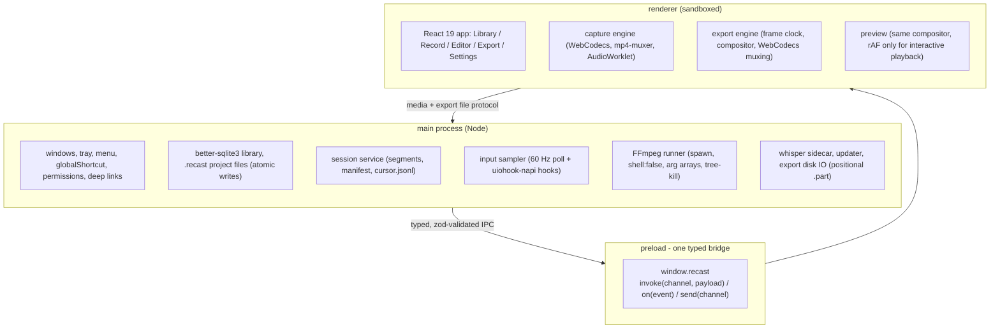

# Architecture

## At a glance

| Layer | Runs in | Owns | Never does |
|---|---|---|---|
| **Main** | Node (Electron main) | OS integration: windows, tray, shortcuts, permissions, file IO, SQLite library, session service, input sampler, FFmpeg/whisper supervision, updater, deep links | Touch pixels |
| **Preload** | Isolated bridge | One typed contract: `window.recast.invoke / on / send` | Expose Node to the page |
| **Renderer** | Sandboxed Chromium | Capture, preview, export - everything that needs the GPU and WebCodecs | Touch the filesystem or spawn processes |

One direction of trust. The renderer never reaches Node directly; every message crosses the validated IPC
contract.

## Process model

- **Main owns the OS.** Windows, tray, shortcuts, permissions, file IO, FFmpeg/whisper supervision, updater,
  deep links (`recast://`), single instance. The renderer never touches Node.
- **Renderer owns pixels.** Capture, preview and export all run in the renderer where the GPU and WebCodecs
  live.
- **Preload is one typed bridge.** `window.recast` with `invoke(channel, payload)`, `on(event, handler)`,
  `send(channel, payload)`. The contract version is asserted at startup.

## IPC

- Every channel is declared once in `packages/shared/src/ipc.ts` as `{ req: zodSchema, res: zodSchema }`.
- Main validates requests (`ipc.ts` registry); preload validates responses and event payloads before they
  reach React.
- A malformed payload fails loudly with the channel name - no silent `undefined` propagation.
- Errors cross as `{ __error: string }` and throw on the caller side.

## Storage

| Data | Location | Format |
|---|---|---|
| Settings | `<data>/settings.json` | JSON, atomic writes |
| Library index | `<data>/library.db` | better-sqlite3, WAL |
| Projects | `<data>/projects/<id>.recast` | JSON (schemaVersion 1), atomic, autosaved every 5 s |
| Recording sessions | `<data>/recordings/<sessionId>/` | `session.json` manifest + `seg-NNNN.mp4` fragments + `cursor.jsonl` |
| FFmpeg (in-app install) | `<data>/bin/ffmpeg/` | binaries + manifest.json |
| Whisper models | `<data>/models/` | ggml files |
| Capture diagnostics | `<data>/logs/capture.log` | NDJSON, 512 KB, one rotation slot |

`<data>` = `%APPDATA%\Recast` / `~/Library/Application Support/Recast` / `~/.config/recast`, or the
executable directory in portable mode.

## Failure domains

| Failure | Blast radius | Recovery |
|---|---|---|
| App crash mid-recording | Current 2 s fragment (unclosed) | Closed segments are complete MP4s; `session.json` lists them; the Library offers recovery and remuxes with `ffmpeg -c copy` |
| Renderer crash | Recording dies, segments survive | Same recovery path; main marks the session `crashed` |
| Disk full | Recording degrades | Disk-space guard reported in the tray state; the recorder error is surfaced, never silently truncated |
| FFmpeg missing | Utility features degrade | Launch-time `-version` probe (2 s timeout); affected features show a Repair button; core record-edit-export is unaffected |
| whisper.cpp missing | Captions degrade | Precise message with the install command; never a fake transcript |
| Export cancel | Nothing | Bytes live in `.part`; renamed only after mux and verify |
| Power loss during settings/project write | Nothing | tmp + rename atomic writes everywhere |

## Clock discipline

The renderer capture clock and the main input sampler both use `(Date.now() - sessionStartEpochMs) / 1000`
minus paused time. One shared epoch (`recorder:start` returns `startEpochMs`) keeps cursor events aligned
with video frames across the process boundary. Pauses subtract on both sides (`inputSampler.pause/resume` and
the recorder pause bookkeeping).

## Determinism

The compositor is a pure function of `(project, timeUs)` producing a draw plan, and the zoom camera is a
fixed-step (60 Hz) integrated track evaluated by binary search plus lerp. Preview and export call the same
`computeComposition` and `drawComposition`; export steps the frame clock at `1/fps` while preview steps at
rAF for interactivity. The golden-frame SSIM harness (planned, see [STATUS.md](../STATUS.md)) will lock
preview/export parity at SSIM >= 0.995.

## Related

- [security.md](security.md) - the trust boundaries in practice
- [editing.md](editing.md) - the compositor and zoom maths
- [export.md](export.md) - frame clock and encoder chain
- [build.md](build.md) - workspace layout
- [packaging.md](packaging.md) - how this ships
